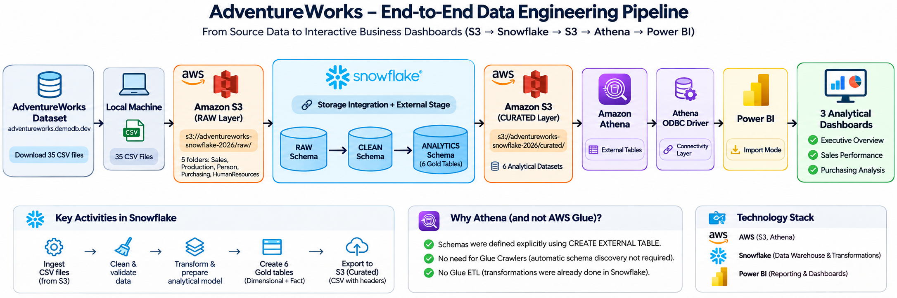
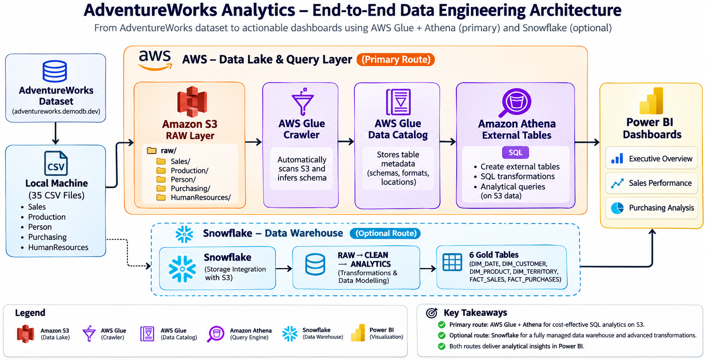
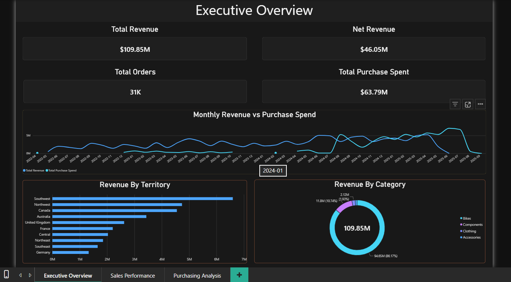
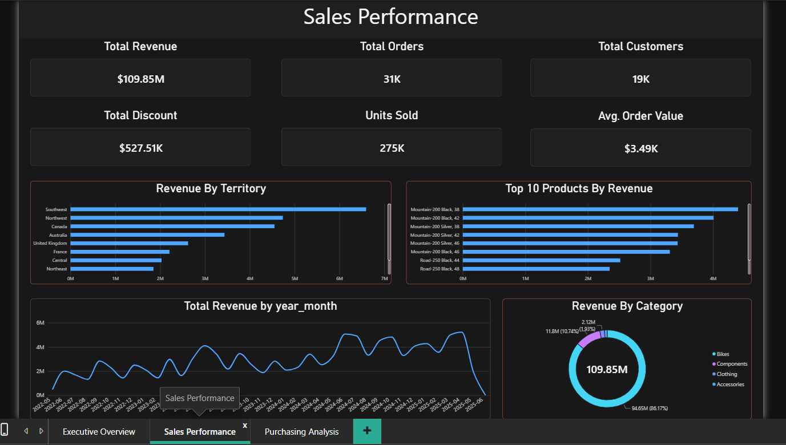

# AdventureWorks End-to-End Data Engineering Project

An end-to-end data engineering project that builds a cloud-based analytics pipeline using **AWS S3, Snowflake, Amazon Athena, and Power BI**. The project takes AdventureWorks CSV datasets from raw storage through ingestion, transformation, dimensional modelling, and reporting.

The implementation uses Snowflake for data processing and modelling, S3 for raw and curated storage, Athena to query the curated files, and Power BI for interactive dashboards.

---

## Architecture

### Implemented data pipeline

The diagram below shows the architecture implemented in this project.



**Pipeline flow:**

1. **Source data** – Downloaded 35 AdventureWorks CSV files.
2. **Amazon S3 – Raw layer** – Uploaded the source files to the `raw/` prefix, organized by business domain.
3. **Snowflake – RAW schema** – Configured an S3 storage integration and external stage, then ingested the CSV files into Snowflake.
4. **Snowflake – CLEAN schema** – Applied data cleaning, type standardization, and validation checks.
5. **Snowflake – ANALYTICS schema** – Built the Gold dimensional model: four dimensions and two fact tables.
6. **Amazon S3 – Curated layer** – Exported the six Gold tables from Snowflake to S3.
7. **Amazon Athena** – Created external tables manually over the curated S3 data and queried the datasets.
8. **Power BI** – Connected through the Athena ODBC driver and imported the six Gold tables to build three dashboards.

### Alternative architecture

The following diagram shows alternative integration paths considered during the project. These are architectural options, not additional pipeline steps claimed as implemented.



---

## Technology Stack

| Area | Technology | Purpose |
|---|---|---|
| Source data | AdventureWorks CSVs | Source datasets |
| Object storage | AWS S3 | Raw and curated data storage |
| Access management | AWS IAM | Permissions and role-based access |
| Data warehouse | Snowflake | Data ingestion, cleaning, transformation, and modelling |
| Data catalog / query | Amazon Athena | SQL queries over curated S3 files |
| BI connectivity | Athena ODBC Driver | Connects Power BI to Athena |
| Visualization | Power BI Desktop | Dashboards and reporting |
| Version control | Git / GitHub | Project source management |

---

## Data Organization

### S3 bucket

The project uses the S3 bucket:

`adventureworks-snowflake-2026`

Key prefixes:

```text
adventureworks-snowflake-2026/
├── raw/
│   ├── HumanResources/
│   ├── Person/
│   ├── Production/
│   ├── Purchasing/
│   └── Sales/
├── curated/
│   ├── DIM_CUSTOMER/
│   ├── DIM_DATE/
│   ├── DIM_PRODUCT/
│   ├── DIM_TERRITORY/
│   ├── FACT_PURCHASES/
│   └── FACT_SALES/
└── athena-results/
```

### Snowflake database

Database: `ADVENTUREWORKS_DB`

| Schema | Responsibility |
|---|---|
| `RAW` | Source data ingested from S3 |
| `CLEAN` | Cleaned and standardized datasets |
| `ANALYTICS` | Gold dimension and fact tables |

### Gold data model

The analytics layer contains six tables:

**Dimension tables**
- `DIM_CUSTOMER`
- `DIM_DATE`
- `DIM_PRODUCT`
- `DIM_TERRITORY`

**Fact tables**
- `FACT_SALES`
- `FACT_PURCHASES`

These tables are exported to the S3 `curated/` prefix and exposed through Athena external tables for reporting.

---

## Repository Structure

```text
AdventureWorks-End-to-End-Data-Engineering/
│
├── architecture/
│   ├── AdventureWorks_Data_Engineering_Pipeline.png
│   └── Alternative_Architecture.png
│
├── docs/
│   ├── 01_Project_Overview.md
│   ├── 02_Data_Architecture.md
│   ├── 03_AWS_S3_Setup.md
│   ├── 04_Snowflake_Implementation.md
│   ├── 05_Athena_Integration.md
│   ├── 06_PowerBI_Integration.md
│   └── 07_Data_Transformations.md
│
├── powerbi/
│   ├── screenshots/
│   │   ├── Executive_Overview.png
│   │   ├── Purchasing_Analysis.png
│   │   └── Sales_Performance.png
│   └── AdventureWorks_End_to_End_Data_Engineering_Dashboard.pbix
│
├── sql/
│   ├── Refined_sql_files/
│   │   ├── 01_environment_and_storage_setup.sql
│   │   ├── 02_initial_sales_raw_ingestion.sql
│   │   ├── 03_remaining_raw_ingestion_33_tables.sql
│   │   ├── 04_raw_discovery_and_validation.sql
│   │   ├── 05_clean_layer_transformations_and_checks.sql
│   │   ├── 06_analytics_gold_models_and_validation.sql
│   │   ├── 07_business_analysis_queries.sql
│   │   └── 08_export_gold_tables_to_s3.sql
│   │
│   ├── 01_AdventureWorks_Setup.sql
│   ├── Athena_Sql_File.sql
│   └── Raw_ingestion.sql
│
└── .gitignore
```

---

## SQL Scripts

The `sql/` directory keeps the original SQL scripts at its root and contains an organized version in `Refined_sql_files/`.

| Script | Description |
|---|---|
| `01_environment_and_storage_setup.sql` | Snowflake database, schemas, S3 integration, stages, and file formats |
| `02_initial_sales_raw_ingestion.sql` | Initial ingestion of the two SalesOrder datasets |
| `03_remaining_raw_ingestion_33_tables.sql` | Generated SQL for ingesting the remaining 33 CSV datasets |
| `04_raw_discovery_and_validation.sql` | Raw file discovery and validation / ingestion-generation work retained from the original setup |
| `05_clean_layer_transformations_and_checks.sql` | CLEAN-layer transformations and validation queries |
| `06_analytics_gold_models_and_validation.sql` | Gold dimensions, fact tables, and validation checks |
| `07_business_analysis_queries.sql` | Analytical queries over the Gold layer |
| `08_export_gold_tables_to_s3.sql` | Export of Gold tables to the S3 curated layer |

The original scripts are retained separately:

- `01_AdventureWorks_Setup.sql`
- `Raw_ingestion.sql`
- `Athena_Sql_File.sql`

The original files are useful for tracing the project implementation. The refined scripts are organized for easier navigation and review.

---

## Data Ingestion and Transformation

### Raw ingestion

- Downloaded 35 CSV files from the AdventureWorks dataset source.
- Organized files into five business-domain folders in S3.
- Configured Snowflake access to S3 using a storage integration and external stage.
- Used schema inference and `COPY INTO` statements to create and load the RAW tables.

### Cleaning and validation

The CLEAN layer was created from the RAW tables. Work included checks for nulls, duplicate keys, invalid values, and referential integrity, along with data type and numeric precision standardization where required.

### Analytics modelling

The ANALYTICS layer contains the six Gold tables used for reporting. Dimension tables provide descriptive business context, while fact tables hold sales and purchasing measures.

### Athena integration

The six curated datasets were exposed in Athena using manually created external tables over their S3 locations. A Glue Crawler was attempted but returned an account-level `AccessDenied` error, so the external tables were created manually. **Glue ETL jobs were not used**; transformations were performed in Snowflake.

---

## Power BI Dashboards

Power BI connects to Amazon Athena through the Athena ODBC driver. The six Gold tables are loaded using **Import mode**, rather than DirectQuery, to avoid repeated query execution against Athena during report interaction.

The project includes three report pages:

### Executive Overview


### Sales Performance


### Purchasing Analysis


The Power BI project file is available at:

`powerbi/AdventureWorks_End_to_End_Data_Engineering_Dashboard.pbix`

---

## Documentation

Detailed implementation notes are available in the `docs/` directory:

- [Project Overview](docs/01_Project_Overview.md)
- [Data Architecture](docs/02_Data_Architecture.md)
- [AWS S3 Setup](docs/03_AWS_S3_Setup.md)
- [Snowflake Implementation](docs/04_Snowflake_Implementation.md)
- [Athena Integration](docs/05_Athena_Integration.md)
- [Power BI Integration](docs/06_PowerBI_Integration.md)
- [Data Transformations](docs/07_Data_Transformations.md)

---

## Security Notes

This repository should contain project code and documentation, not credentials.

- Do not commit AWS access keys, secret keys, Snowflake passwords, private keys, or generated external IDs.
- Use placeholders for account-specific identifiers in examples.
- Keep local environment files and credential files excluded through `.gitignore`.
- Review the original SQL scripts and documentation for account IDs, role ARNs, bucket policies, or other environment-specific details before publishing the repository.

---

## Project Highlights

- End-to-end cloud data pipeline across AWS and Snowflake.
- Ingestion of 35 CSV source datasets.
- Layered data organization using RAW, CLEAN, and ANALYTICS schemas.
- Data quality checks and dimensional modelling.
- Six Gold tables exported to S3 and queried through Athena.
- Power BI reporting using Athena ODBC and Import mode.
- Organized SQL scripts and implementation documentation.

---

*This repository documents the implemented AdventureWorks project. The alternative architecture diagram is included for design context and should not be interpreted as a second implemented pipeline.*
