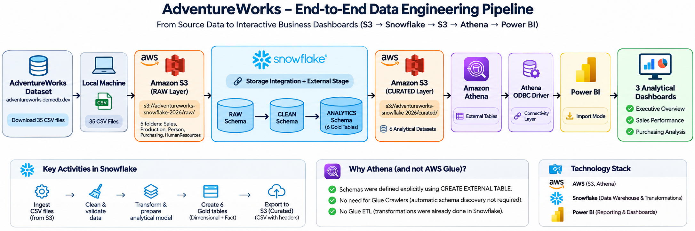
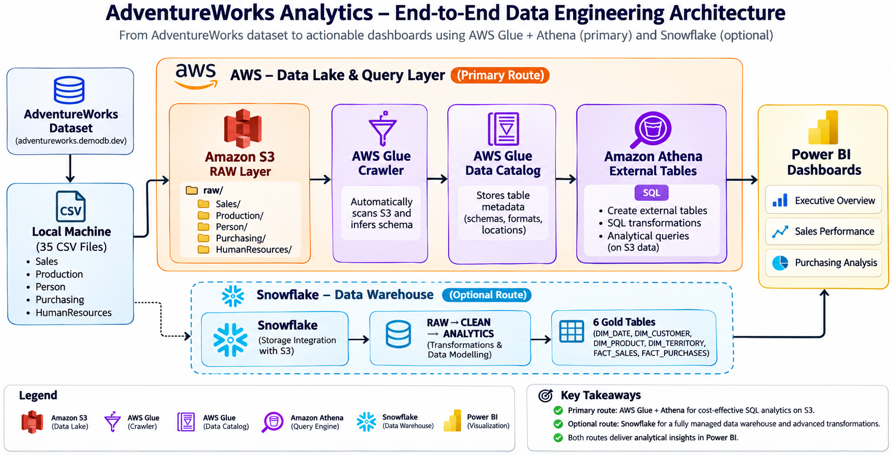

# Data Architecture

## 1. Overview

The AdventureWorks project follows an end-to-end data engineering architecture using AWS S3, Snowflake, Amazon Athena, and Power BI.

The pipeline separates raw data storage, data cleaning, analytical transformations, and reporting.

## 2. Architecture Workflow

The implemented pipeline follows this sequence:

1. **Source Data:** Downloaded 35 CSV files from the AdventureWorks dataset.
2. **Amazon S3 - Raw Layer:** Uploaded the original CSV files to the S3 bucket `adventureworks-snowflake-2026`, organized into five business-domain folders.
3. **Snowflake - RAW Schema:** Connected Snowflake to S3 using an AWS storage integration and external stage. Loaded the source data into Snowflake.
4. **Snowflake - CLEAN Schema:** Cleaned and transformed the 35 datasets and performed validation checks.
5. **Snowflake - ANALYTICS Schema:** Created six analytical Gold tables for reporting.
6. **Amazon S3 - Curated Layer:** Exported the six Gold tables from Snowflake to separate folders under the `curated/` prefix.
7. **Amazon Athena:** Created six external tables in the `adventureworks_gold` database to query the curated CSV files in S3.
8. **Power BI Connection:** Configured the Athena ODBC driver and connected Power BI to Athena.
9. **Power BI Reporting:** Imported the six Gold tables into Power BI and developed three analytical dashboards.

## 3. Architecture Diagram

## 4. AWS S3 Storage Structure

The project uses a single S3 bucket:

`adventureworks-snowflake-2026`

The bucket contains three main prefixes:

- `raw/` - Stores the original 35 CSV files.
- `curated/` - Stores the six analytical Gold datasets exported from Snowflake.
- `athena-results/` - Stores query results generated by Amazon Athena.

The raw data is organized into five business-domain folders:

- HumanResources
- Person
- Production
- Purchasing
- Sales

The curated data is organized into six folders, one for each Gold table.

## 5. Snowflake Data Layers

The Snowflake database is named `ADVENTUREWORKS_DB` and contains three schemas:

| Schema | Purpose |
|---|---|
| RAW | Stores data ingested from the source CSV files. |
| CLEAN | Contains cleaned and transformed datasets. |
| ANALYTICS | Contains the final analytical Gold tables. |

The six Gold tables created in the ANALYTICS schema are:

- DIM_CUSTOMER
- DIM_DATE
- DIM_PRODUCT
- DIM_TERRITORY
- FACT_PURCHASES
- FACT_SALES

## 6. Snowflake to Amazon S3 Integration

Snowflake accesses the raw S3 data through an AWS storage integration and external stage.

The integration uses an AWS IAM role with a trust relationship that allows Snowflake to assume the role securely.

After transformations, Snowflake exports the Gold tables to the curated S3 prefix. These files are then accessed by Athena.

## 7. Amazon Athena Integration

An Athena database named `adventureworks_gold` was created.

Six external tables were manually defined, each pointing to its corresponding folder in the curated S3 prefix.

The tables use CSV SerDe configuration and skip the header row.

A Glue Crawler was attempted for automatic table discovery, but an account-level AccessDenied error prevented its use. Therefore, the six external tables were created manually in Athena.

No Glue ETL jobs were required because data cleaning and transformations were already performed in Snowflake.

Athena uses the AWS Glue Data Catalog to maintain the metadata for these tables.

## 8. Power BI Integration

Power BI connects to Amazon Athena using the Athena ODBC driver.

The project uses **Import Mode** rather than DirectQuery. The six curated Gold datasets are imported into Power BI for dashboard development.

Three analytical dashboards were developed using these datasets.

## 9. Alternative Architecture

The project also considers an alternative reporting approach in which Power BI connects directly to Snowflake instead of going through Athena.

This is an alternative design, not the implemented pipeline.

## 10. Key Architectural Decisions

- **S3 as data storage:** Separates raw source files and curated analytical outputs.
- **Snowflake for transformations:** Centralizes data cleaning, validation, and analytical modeling.
- **Athena for querying:** Enables SQL access to curated files stored in S3.
- **Manual external table creation:** Used when Glue Crawler discovery was blocked by an AccessDenied error.
- **Power BI Import Mode:** Chosen to avoid repeated Athena query execution associated with DirectQuery.

---

